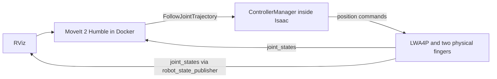

# LWA4P + WSG 50 in Isaac Sim with MoveIt 2 Humble

From the root of the `lwa4p_driver` repository:

```bash
./isaac/moveit/run.sh
```

This opens Isaac Sim with the physical arm model and RViz with the MotionPlanning
panel. Wait for `Physical robot ready` in the terminal. In RViz:

1. Select Planning Group **arm**.
2. Select Goal State **ready**, **home**, **work1**, or **work2**, or move the TCP marker.
3. Click **Plan**, then **Execute**, or **Plan & Execute**.
4. For the gripper, select group **gripper** and state **open** or **closed**.

Executing a trajectory moves the robot in Isaac. RViz receives measured joint
states from the simulator. Press Ctrl+C in the terminal or close Isaac to stop
the session. To start a new session after Play/Stop, run the command again.

Other modes:

```bash
./isaac/moveit/run.sh --no-rviz   # Isaac GUI, MoveIt without RViz
./isaac/moveit/run.sh --headless  # no GUI windows
./isaac/moveit/run.sh --test      # run the execution test, then stop
```

The launcher uses an existing Sim 6.2 installation and the `lwa4p:humble` image.
If the image is missing, it builds it from `docker/Dockerfile`. Configuration
files are mounted directly into the container; changing them requires no image
rebuild.

All launch scripts are included in this repository. To use a standalone Sim
installation at a custom location, set `ISAACSIM_PATH`:

```bash
ISAACSIM_PATH=/path/to/isaac-sim-6.2.0 ./isaac/moveit/run.sh
```

By default, the launcher checks the sibling installation at
`../isaac-setup/runtime/isaac-sim-6.2.0`, then `~/isaacsim`.
The Isaac distribution is not included in Git. The shared RoboCup workspace also
provides the compatibility launcher `./isaac-setup/lwa4p-moveit.sh`.

Defaults: **ROS_DOMAIN_ID=68**, Fast DDS, and simulation time. To use another domain:

```bash
ROS_DOMAIN_ID=69 ./isaac/moveit/run.sh
```

Run one instance per domain. To inspect it from another terminal with a native
Humble installation:

```bash
source /opt/ros/humble/setup.bash
export ROS_DOMAIN_ID=68 ROS_LOCALHOST_ONLY=0 RMW_IMPLEMENTATION=rmw_fastrtps_cpp
ros2 control list_controllers
ros2 topic echo /joint_states
```

## Architecture



`arm_controller` and `gripper_controller` are standard
`joint_trajectory_controller/JointTrajectoryController` instances. Together with
`joint_state_broadcaster`, they run in `isaacsim.ros2.control` using the
`isaacsim_ros2_control/IsaacSimSystem` hardware interface.
MoveIt, robot_state_publisher, and RViz run in an Ubuntu 22.04/Humble container;
the simulator runs on the host with Python 3.12.

Planning and physics use the same model from `isaac/lwa4p_wsg50.urdf`.
`prepare.py` generates the ROS description with `file://` URIs for STL meshes and
adapts the SRDF. All six arm joints are preserved. The gripper has two independent
joints: `gripper_finger_left_joint` and `gripper_finger_right_joint`. Each opens
to 0.0425 m, giving a total gap of 0.085 m. The virtual `gripper_joint` from the
real WSG configuration is not used here. The real driver and Gazebo
configurations are unchanged.

The table is a physical collider in Isaac and the `isaac_workbench` collision
object in MoveIt. Sim 6.2's native live exporter rejects the model's separate
fixed camera branch. The adapter adds a standard `<ros2_control>` block to the
source URDF and calls the same native backend. This call depends on the installed
Sim 6.2 API; rerun `--test` after upgrading Sim.

## Completed verification — October 23, 2026

The `--test` command successfully completed:

- activation of all three controllers;
- a direct arm trajectory with measured first-axis movement of approximately 0.12 rad;
- verification of the table in the MoveIt collision scene;
- **MoveIt planning and execution for arm**: 24 points, result `SUCCESS`, action status `SUCCEEDED`;
- physical closing of both fingers;
- **MoveIt planning and execution for gripper**: 24 points, `SUCCESS` and `SUCCEEDED`.

After fixing the STL URIs, the test was repeated with collision geometry loaded.
The maximum final arm joint error was approximately 0.0094 rad.
[Report with target and measured positions](verification/execution.json).

The GUI launch was also verified: both windows opened, RViz loaded the STL meshes
without resource errors, and Plan & Execute completed with `SUCCEEDED`.
[GUI report](verification/gui.json).

Logs and generated resources are stored in `isaac/moveit/.runtime/`:
`simulation.log`, `moveit.log`, `execution.log`, `robot.urdf`, `robot.srdf`, and USD.
This directory is excluded from Git. Override its location with
`LWA4P_ISAAC_CACHE`; the latest execution report is saved under
`$LWA4P_ISAAC_CACHE/reports/`. Reports in `verification/` record previous
integration runs; they are not results of a new launch.
Free arm movement and gripper control have been verified. Physical object
grasping and RGB/depth are outside this scenario. The D435 housing is preserved.

The installed MoveIt 2.5.10 exhibited a `SIGSEGV` when `move_group` shut down after
SIGINT, in the `rclcpp::CallbackGroup` destructor. In the verified sessions, this
occurred during shutdown after successful execution; the launcher removes the
container and stops Isaac. The stack trace is saved in `moveit.log`.
This integration does not fix that shutdown defect.

The laptop remains limited to 16 GB RAM and 8 GB VRAM. The setup uses four
threads, a small scene, and RViz with software OpenGL. Initial shader warmup
may take several minutes.

Based on the [official Sim 6.2 ROS 2 Control workflow](https://docs.isaacsim.omniverse.nvidia.com/6.2.0/ros2_tutorials/robot_control/tutorial_ros2_control.html).
