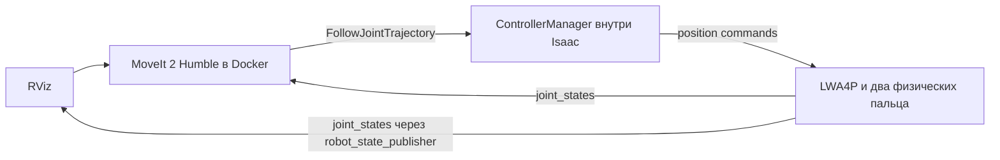

# LWA4P + WSG 50 в Isaac Sim с MoveIt 2 Humble

Из корня репозитория `lwa4p_driver`:

```bash
./isaac/moveit/run.sh
```

Откроются Isaac Sim с физической моделью руки и RViz с панелью MotionPlanning.
Дождитесь сообщения `Physical robot ready` в терминале. В RViz:

1. Выберите Planning Group **arm**.
2. Выберите Goal State **ready**, **home**, **work1**, **work2** либо переместите маркер TCP.
3. Нажмите **Plan**, затем **Execute** или **Plan & Execute**.
4. Для захвата выберите группу **gripper**, состояние **open** или **closed**.

Траектория двигает робот в окне Isaac. RViz получает измеренные состояния
суставов от симулятора. Ctrl+C в терминале или закрытие Isaac останавливает
связку. Для нового сеанса после Play/Stop запустите команду заново.

Другие режимы:

```bash
./isaac/moveit/run.sh --no-rviz   # окно Isaac, MoveIt без RViz
./isaac/moveit/run.sh --headless  # оба процесса без окон
./isaac/moveit/run.sh --test      # конечный тест исполнения и остановка
```

Используются установленный Sim 6.2 и образ `lwa4p:humble`. Если образа нет,
запускатель собирает его из `docker/Dockerfile`. Конфигурации
подключаются в контейнер напрямую; их изменение не требует пересборки образа.

Все скрипты запуска входят в этот репозиторий. Для произвольного расположения
самостоятельной установки Sim задайте `ISAACSIM_PATH`:

```bash
ISAACSIM_PATH=/path/to/isaac-sim-6.2.0 ./isaac/moveit/run.sh
```

По умолчанию проверяются соседняя установка
`../isaac-setup/runtime/isaac-sim-6.2.0` и `~/isaacsim`.
Дистрибутив Isaac в Git не включён. В общей папке RoboCup также сохранён
совместимый запуск `./isaac-setup/lwa4p-moveit.sh`.

По умолчанию: **ROS_DOMAIN_ID=68**, Fast DDS, часы симуляции. Другой домен:

```bash
ROS_DOMAIN_ID=69 ./isaac/moveit/run.sh
```

Используйте один экземпляр на домен. Наблюдение из другого терминала с
нативным Humble:

```bash
source /opt/ros/humble/setup.bash
export ROS_DOMAIN_ID=68 ROS_LOCALHOST_ONLY=0 RMW_IMPLEMENTATION=rmw_fastrtps_cpp
ros2 control list_controllers
ros2 topic echo /joint_states
```

## Подключение



`arm_controller` и `gripper_controller` — стандартные
`joint_trajectory_controller/JointTrajectoryController`. Они и
`joint_state_broadcaster` работают в `isaacsim.ros2.control` через настоящий
аппаратный интерфейс `isaacsim_ros2_control/IsaacSimSystem`.
MoveIt, robot_state_publisher и RViz запускаются в Ubuntu 22.04/Humble
контейнере; симулятор с Python 3.12 — на хосте.

Планирование и физика используют одну модель из `isaac/lwa4p_wsg50.urdf`.
`prepare.py` генерирует ROS-описание с `file://` URI для STL и адаптирует SRDF.
Шесть осей руки сохранены. У захвата два независимых сустава:
`gripper_finger_left_joint`, `gripper_finger_right_joint`; каждый открывается
до 0.0425 м, общий зазор — 0.085 м. Виртуальный `gripper_joint` из конфигурации
реального WSG здесь не используется. Конфигурации реального драйвера и Gazebo
не изменены.

Стол есть как физический коллайдер в Isaac и collision object
`isaac_workbench` в MoveIt. Родной live-exporter Sim 6.2 отвергает модель с
отдельной неподвижной веткой камеры. Адаптер добавляет стандартный
`<ros2_control>` блок в исходный URDF и вызывает тот же native backend.
Этот вызов привязан к установленному API Sim 6.2; после обновления Sim
повторите `--test`.

## Выполненная проверка — 23 октября 2026

Команда `--test` успешно выполнила:

- загрузку трёх контроллеров в `active`;
- прямую траекторию руки с измеренным движением первой оси ≈ 0.12 рад;
- проверку стола в сцене коллизий MoveIt;
- **планирование и исполнение MoveIt для arm**: 24 точки, код `SUCCESS`, action `SUCCEEDED`;
- физическое закрытие двух пальцев;
- **планирование и исполнение MoveIt для gripper**: 24 точки, `SUCCESS` и `SUCCEEDED`.

После исправления URI STL тест повторён с загруженной геометрией коллизий.
Максимальная конечная ошибка сустава руки — около 0.0094 рад.
[Отчёт с целевыми и измеренными позициями](verification/execution.json).

Графический запуск также проверен: оба окна открыты, RViz загрузил STL без
ошибок ресурсов и выполнил Plan & Execute с результатом `SUCCEEDED`.
[Отчёт GUI](verification/gui.json).

Логи и сгенерированные ресурсы: `isaac/moveit/.runtime/` —
`simulation.log`, `moveit.log`, `execution.log`, `robot.urdf`, `robot.srdf`, USD.
Каталог исключён из Git. Расположение можно изменить через
`LWA4P_ISAAC_CACHE`; последний отчёт исполнения сохраняется под
`$LWA4P_ISAAC_CACHE/reports/`. Проверочные отчёты в `verification/` являются
историческими результатами выполненной интеграции, а не новым запуском.
Проверены свободное движение руки и управление захватом; физический захват
предметов и RGB/depth в этот сценарий не входят. Корпус D435 сохранён.

В установленном MoveIt 2.5.10 зафиксирован `SIGSEGV` при завершении
`move_group` после SIGINT, в деструкторе `rclcpp::CallbackGroup`. В проверенных
сеансах это происходило после успешного исполнения, при остановке; запускатель
удаляет контейнер и завершает Isaac. Стек сохранён в `moveit.log`.
Этот дефект завершения данной интеграцией не исправлен.

На ноутбуке остаются ограничения 16 ГБ RAM / 8 ГБ VRAM. Используются четыре
потока, небольшая сцена и RViz с программным OpenGL. Первый прогрев шейдеров
может занимать несколько минут.

Основа: [официальный ROS 2 Control workflow Sim 6.2](https://docs.isaacsim.omniverse.nvidia.com/6.2.0/ros2_tutorials/robot_control/tutorial_ros2_control.html).
