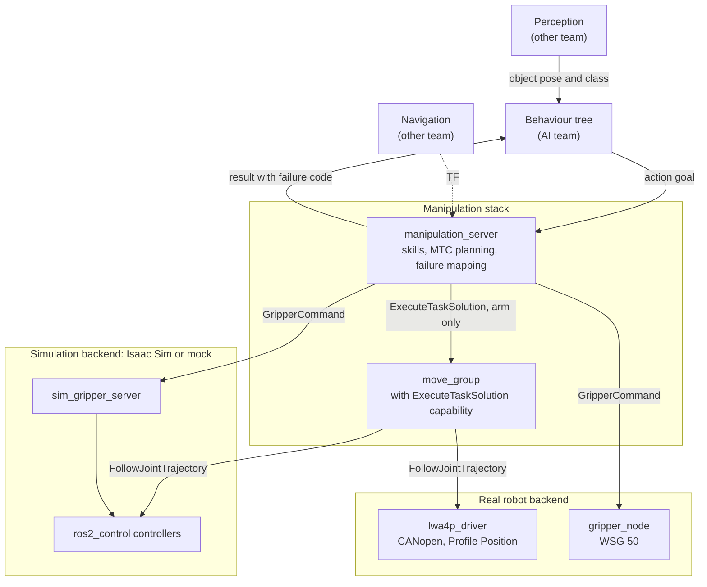
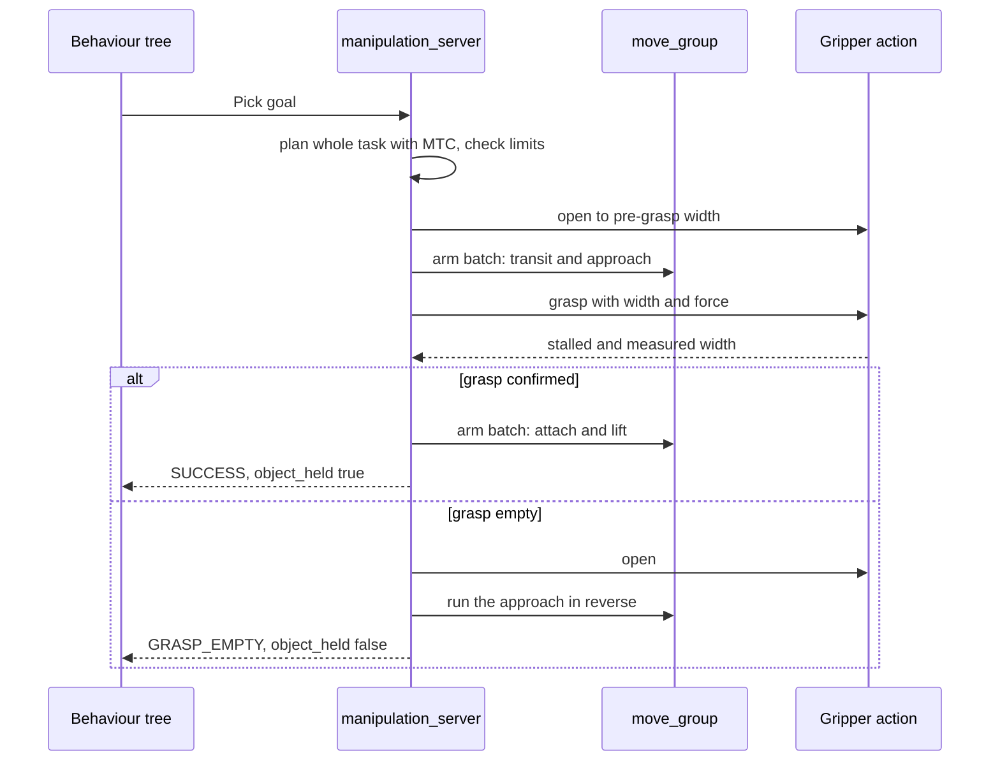

# Manipulation stack: implementation proposal

- **Status:** proposal for team review
- **Date:** 2026-11-01
- **Target:** RoboCup 2027
- **Platform:** ROS 2 Jazzy on Ubuntu 24.04, MoveIt 2.12, MTC 0.1.8, Isaac Sim 6.2
- **Related:** [manipulation_architecture.txt](manipulation_architecture.txt) (the layer diagram, updated to match this proposal), [AGENTS.md](AGENTS.md) (how the current code works)

## 1. Summary

We propose one ROS 2 node, `manipulation_server`, that offers the AI team's behaviour tree (BT) a small set of ROS 2 actions: `Pick`, `Place`, `MoveToNamed`, `MoveToPose` and `SetGripper`. We call each of these a *skill*. Each skill plans its whole motion with MoveIt Task Constructor (MTC), runs it through the existing `move_group`, and always ends with a result that tells the BT exactly what happened.

The real arm keeps the Python CAN driver. Simulation keeps `ros2_control`, now on Isaac Sim, which replaces Gazebo as the only physics simulator. Everything above the action interface is the same code on both.

| # | Decision | Why |
|---|---|---|
| 1 | Every goal ends with a result carrying a failure code, including a busy server | The BT can branch on the cause of any failure (section 7) |
| 2 | One server, one skill at a time | There is one arm, and it keeps the planning scene consistent |
| 3 | MTC plans the whole skill; the BT works at skill level | MTC only commits to a grasp if the approach, lift and retreat are all feasible |
| 4 | Execution is split at gripper events | It allows a per-object grip force and a grasp check *before* the arm lifts |
| 5 | The gripper behaves the same on every backend | A small simulation adapter copies the real gripper's action behaviour |
| 6 | Every trajectory is checked against the real driver's rules, on every backend | Plans that would fail on the real arm fail in simulation first |
| 7 | `CartesianPath` for straight moves, OMPL for free motion, KDL for inverse kinematics | Best evidence so far: Pilz failed `Place`, and `pick_ik` gave no benefit. To be repeated on Jazzy. |
| 8 | No MoveIt Servo, velocity path or real-time tuning | The Python driver accepts only trajectory goals in Profile Position mode |
| 9 | Isaac Sim for physics, mock hardware for everything else, and start with a grasp test | Gazebo is dropped, and object grasping has never been tested in Isaac (section 13.3) |

**How far this is proven.** Before the move to Jazzy and Isaac, we built a throwaway prototype of the riskiest ideas on the previous stack (MoveIt 2.5.10, MTC 0.1.3, Gazebo Classic). It picked and placed the test tube under Gazebo physics, detected an empty grasp and recovered from it. Every arm trajectory planned with the proper configuration also passed the real driver's own validation code. **None of this has been run on Jazzy or in Isaac Sim.** We then read the Jazzy source of MoveIt and MTC: the code paths the design depends on carry over, with a few API changes. The physics results do not carry over, because the simulator changed (Appendix A). Nothing has been run on the real robot.

**What we need from other teams:**

- **AI team:** review section 6 and section 7, build on Jazzy, and read the failure code in the BT nodes (section 7.6 shows a trap in common wrappers).
- **Perception team:** object position, class and, for non-round objects, orientation (section 10.2).
- **Navigation team:** a TF link between the mobile base and the arm, and a base position within reach (section 10.3).

**What we need to decide:** which machine runs Isaac. This project's physics testing depends on it (section 13.3).

## 2. Scope and ownership

| Area | Owner | Role in this proposal |
|---|---|---|
| Task logic, BT nodes, recovery policy | AI team | Calls our actions and decides what to do about failures |
| Object detection and poses | Perception team | Supplies the input to `Pick` |
| Base motion and localisation | Navigation team | Positions the base and provides TF |
| Skills, MTC tasks, planning scene, gripper contract | Manipulation team | This document |
| Failure enumeration | Manipulation team | Section 7.2 is a starting draft, not the final list |
| Real arm and gripper drivers | Manipulation team | No changes (team decision) |

Out of scope: writing the BT, a `ros2_control` hardware interface for the real arm, `ros2_canopen`, and object detection.

### Changes from the first diagram

`manipulation_architecture.txt` now matches this proposal. This table records what changed from its first version (commit `27fed6e`).

| Layer in the first version | In this proposal |
|---|---|
| Compute allocation, CPU core isolation | Dropped for the real arm. Its driver is a 20 Hz Python loop, so there is nothing to isolate. GPU allocation belongs to the perception team. |
| Perception and world model | Owned by another team. We define the interface only. |
| BehaviorTree.CPP supervisor | Owned by the AI team. It orchestrates skills, not motion stages. |
| "Velocity bypass" | Removed. |
| MTC | Kept. It is the core of the skill server. |
| OMPL | Kept for free motion. |
| Pilz LIN / PTP | Replaced by MTC's `CartesianPath` for straight moves. Pilz stays available as an option (decision 7). |
| PickIK / TRAC-IK | KDL stays for now. `pick_ik` measured no better before the migration. Both `pick_ik` and the TRAC-IK plugin have Jazzy binaries, so both join the retest. |
| Ruckig smoothing | Deferred. It only affects OMPL segments, and the real driver resamples every trajectory at 20 Hz anyway. |
| MoveIt Servo | Removed. The real driver has no streaming input. |
| `ros2_control` layer | Simulation only, in Isaac Sim and on mock hardware. |
| `ros2_canopen`, 1 Mbit/s, sync PDO | Removed. The real bus stays at 500 kbit/s through `lwa4p_driver`. |
| Hardware layer | Add the **WSG 50 gripper**, which the diagram omits. It sits on `can1` and is not a CiA 402 device. |

## 3. Architecture



Only one backend runs at a time. The line between the stack and the backends is the same set of ROS interfaces on all of them:

| Interface | Direction | Used for |
|---|---|---|
| `arm_controller/follow_joint_trajectory` | `move_group` to backend | Arm motion |
| `gripper_controller/gripper_cmd` (`GripperCommand`) | server to backend | Gripper motion and grasping |
| `/joint_states` | backend to stack | Measured joint positions |
| `gripper/state` | backend to server | Measured gap between the fingertips, for hold monitoring |

MTC plans **inside the `manipulation_server` process**, not in `move_group`. `move_group` is used for two things: it holds the live planning scene, and it executes trajectories through the `ExecuteTaskSolution` capability.

## 4. Design decisions

### 4.1 One server, skills as actions

All skills live in one node. A skill runner allows one skill at a time, because there is one arm and one planning scene. Running them in separate nodes would need a lock between nodes for no benefit.

The pattern already exists in the repo. [verification_server_ros.cpp](src/lwa4p_mtc_verification/src/verification_server_ros.cpp) has one worker thread and answers `BUSY` to a second request. We reuse the idea, but report `BUSY` through the normal result (section 7).

### 4.2 MTC plans the whole skill, the BT does not see motion stages

The first version of the diagram put "Approach, Grasp, Lift, Transfer, Place" in the BT. MTC already does this, and does it better: it searches through grasp candidates and only accepts one for which the whole sequence is feasible. If those stages were BT nodes, a grasp could be chosen and approached before anyone found out that the lift is impossible.

So the BT asks for `Pick`, and handles the outcome. Perception requests, retries, base moves and speech stay in the BT.

`Pick` and `Place` are separate skills because the robot may drive between them. A single combined task, where MTC picks a grasp that also suits the placement, can be added later if a task needs it.

### 4.3 Execution is split at gripper events

This is the main departure from a standard MTC setup. Normally one call executes the entire solution, gripper included. We split the planned solution at each gripper step instead:

1. Run the arm motion up to the grasp pose.
2. Call the gripper directly, with the force this object needs.
3. Check the measured result.
4. Only if the grasp is good, run the attach and lift.

We need this for three reasons:

- **Grasp check before lifting.** A single execution call cannot stop in the middle to look at the gripper.
- **Per-object force.** MoveIt's gripper handle sends a fixed `max_effort` from its config file. A test tube and a heavy box need different forces.
- **Contact in simulation.** The simulated gripper controllers cannot report a grasp (section 9.3).

The plan stays complete. The lift and retreat are planned before the arm moves, so we keep MTC's guarantee.

Alternatives we rejected:

| Alternative | Problem |
|---|---|
| Execute the whole solution with `Task::execute()` | No grasp check, a fixed force, and it reports any aborted execution as generic `FAILURE`, losing the cause (Appendix B) |
| Plan a separate MTC task per phase | Loses the guarantee that the lift is feasible |
| Put the force into the trajectory's `effort` field | Depends on the field surviving several conversions, and still gives no grasp check |

The prototype confirmed that `ExecuteTaskSolution` accepts these partial solutions, including batches that contain only planning scene changes. That test ran before the migration. In MTC 0.1.8 and MoveIt 2.12.4 this path reads the same, so we expect it to hold, and phase 1 repeats it.

### 4.4 One gripper behaviour on every backend

Today the three backends model the gripper differently (AGENTS.md section 3). All three will serve the same `GripperCommand` action with the same meaning. The real `gripper_node` already defines that meaning, and a small simulation node, `sim_gripper_server`, copies it. Section 9 has the details.

### 4.5 Motion planning choices

| Motion | Solver | Reason |
|---|---|---|
| Free motion between poses | OMPL RRTConnect | Handles obstacles; already works on all backends |
| Approach, lift, retreat | MTC `CartesianPath` | Same algorithm as `SimpleMoveIt.line()`; passed all tests |
| Gripper stages | `JointInterpolationPlanner` | Only used to update the planned state; the real motion goes through the gripper action |

These choices rest on tests from before the migration, so phase 1 repeats them on Jazzy. They are defaults, and a setting can change each of them.

**Pilz:** with the current limits, Pilz LIN failed on the approach (`arm_3_joint` acceleration limit). With realistic Cartesian limits it passed `Pick` but still failed `Place` (`arm_3_joint` deceleration limit). `CartesianPath` passed both at the same speeds. We keep a `linear_solver` setting so Pilz can be retried.

**Inverse kinematics:** across 132 top-down pick positions, KDL solved 56 and `pick_ik` 57, with `pick_ik` taking 0.65 s per success against 0.25 s for KDL. KDL stays until the retest, which also covers the TRAC-IK plugin. This test covers top-down grasps only, so retest again if side grasps become important.

**Ruckig:** on Jazzy it is a planning response adapter (`AddRuckigTrajectorySmoothing`), so it only applies to OMPL segments. `CartesianPath` and `JointInterpolationPlanner` use their own time parameterization instead. The real driver also resamples at 20 Hz, and the drives apply their own motion profile. The existing time parameterization stayed within the velocity and acceleration limits in every test, so we defer Ruckig.

### 4.6 What we deliberately leave out

- **MoveIt Servo and visual servoing.** The real driver accepts `FollowJointTrajectory` goals only.
- **OctoMap.** MTC's `CurrentState` stage can use it, but on a moving robot it goes stale. Start with explicit collision objects (section 10).
- **Automatic retries inside skills.** The BT owns recovery policy. MTC's search over grasp candidates is the only retrying inside a skill.
- **Driver status changes.** Everything here works with `lwa4p_driver` as it is.

## 5. Packages and file changes

### 5.1 New packages

| Package | Type | Contents |
|---|---|---|
| `manipulation_interfaces` | Interfaces | Actions, messages (including the failure enumeration) and services. Depends only on standard message packages, so the AI team can build it without MoveIt. |
| `manipulation_skills` | C++17 | `manipulation_server`. Reuse the `.clang-format` from `lwa4p_mtc_verification`. |
| `manipulation_sim` | Python | `sim_gripper_server`, the simulation gripper adapter. Configured by parameters, no robot-specific code. |
| `lwa4p_bringup` | Launch and config | Launch file for all backends, robot profile, object table, scenes, and the helper scripts moved out of `lwa4p_gazebo`. Hardware-specific, so it keeps the `lwa4p_` prefix. |

The BT package belongs to the AI team and depends only on `manipulation_interfaces`.

```text
src/manipulation_skills/
├── include/manipulation_skills/
│   ├── grasp_candidates.hpp      # no ROS: grasp poses from object and profile
│   ├── trajectory_guard.hpp      # no ROS: real driver's rules
│   ├── plan_segmenter.hpp        # splits a solution at gripper events
│   ├── failure_mapping.hpp       # every internal signal to one failure code
│   ├── skill_server.hpp          # action servers
│   ├── skill_runner.hpp          # one worker, admission, cancel
│   ├── task_builders.hpp         # MTC task per skill
│   ├── segment_executor.hpp      # runs the split plan
│   ├── gripper_client.hpp        # GripperCommand, hold monitor
│   └── scene_manager.hpp         # planning scene, one writer
├── src/
│   └── stages/generate_candidate_poses.cpp
└── test/
```

### 5.2 Changes to existing files

| File | Change |
|---|---|
| [real.launch.py](src/lwa4p_moveit_config/launch/real.launch.py) | Pass `capabilities:=move_group/ExecuteTaskSolutionCapability`. Without it, every skill fails on the real robot. |
| [package.xml](src/lwa4p_moveit_config/package.xml) (moveit_config) | Add `moveit_task_constructor_capabilities`. |
| [joint_limits.yaml](src/lwa4p_moveit_config/config/joint_limits.yaml) | Add `min_position` and `max_position` so plans stay 3° from the drive limits (section 11). |
| [pilz_cartesian_limits.yaml](src/lwa4p_moveit_config/config/pilz_cartesian_limits.yaml) | Replace 1.0 m/s with values this arm can reach, in case Pilz is used. |
| [lwa4p.srdf](src/lwa4p_moveit_config/config/lwa4p.srdf) | Add `ready`, `stow` and `carry` arm states. |
| [prepare.py](isaac/moveit/prepare.py) | Stop adding `ready` itself. |
| [controllers.yaml](isaac/moveit/controllers.yaml) (Isaac) | Remove the gripper's goal and path tolerances, so contact does not abort the controller (section 9.3). |
| [moveit.launch.py](isaac/moveit/moveit.launch.py) (Isaac) | Start `sim_gripper_server`. |
| [Dockerfile](docker/Dockerfile) | Move to Jazzy (section 13.2), and add the new launch file to the build-time checks. |

Section 13.2 lists the other changes the migration needs, including removing `lwa4p_gazebo`. The Python driver's code does not change. `lwa4p_mtc_verification` stays as the Isaac regression test once it builds on Jazzy.

## 6. Action interface

This section is the contract with the AI team. All names are hardware-agnostic. Anything robot-specific comes from configuration (section 12).

### 6.1 Overview

| Name | Kind | Purpose |
|---|---|---|
| `/manipulation/pick` | Action `Pick` | Pick an object |
| `/manipulation/place` | Action `Place` | Put the held object down |
| `/manipulation/move_to_named` | Action `MoveToNamed` | Move to a named arm state such as `stow` or `carry` |
| `/manipulation/move_to_pose` | Action `MoveToPose` | Move the tool centre point (TCP) to a pose |
| `/manipulation/set_gripper` | Action `SetGripper` | Open, move or grasp without arm motion |
| `/manipulation/load_scene` | Service `LoadScene` | Load the static collision scene of a location |
| `/manipulation/update_objects` | Service `UpdateObjects` | Add, replace or remove collision objects |
| `/manipulation/status` | Topic `ManipulationStatus` | Current state, held object, last failure. Latched (transient local QoS). |

Scene updates are services because they finish immediately. Anything that moves hardware is an action.

### 6.2 Action definitions

`Pick.action`:

```text
# Goal
manipulation_interfaces/ObjectDescription object
string[] support_ids        # scene objects the target rests on
string grasp_profile        # "" = use the profile for object.object_class
float32 grasp_force_n       # 0 = profile default
float32 speed_scale         # 0 = default, otherwise 0..1
bool plan_only              # plan and report, do not move
---
# Result
manipulation_interfaces/SkillOutcome outcome
float32 held_width_m
geometry_msgs/PoseStamped grasp_pose
float32 planning_time_s
float32 execution_time_s
---
# Feedback
manipulation_interfaces/SkillFeedback feedback
```

`Place.action`:

```text
# Goal
geometry_msgs/PoseStamped target_pose   # where the centre of the held object should end up
float32 release_height_m                # gap above the surface; 0 = default
float32 speed_scale
bool plan_only
---
# Result
manipulation_interfaces/SkillOutcome outcome
geometry_msgs/PoseStamped placed_pose
float32 planning_time_s
float32 execution_time_s
---
# Feedback
manipulation_interfaces/SkillFeedback feedback
```

`MoveToNamed.action`:

```text
# Goal
string target               # named arm state, e.g. "stow"
float32 speed_scale
bool plan_only
---
# Result
manipulation_interfaces/SkillOutcome outcome
---
# Feedback
manipulation_interfaces/SkillFeedback feedback
```

`MoveToPose.action`:

```text
# Goal
uint8 FREE=0
uint8 LINEAR=1
geometry_msgs/PoseStamped tcp_pose
uint8 motion                # FREE or LINEAR
float32 speed_scale
bool plan_only
---
# Result
manipulation_interfaces/SkillOutcome outcome
---
# Feedback
manipulation_interfaces/SkillFeedback feedback
```

`SetGripper.action`:

```text
# Goal
uint8 OPEN=0
uint8 MOVE=1
uint8 GRASP=2
uint8 command
float32 width_m             # target gap between the fingertips
float32 force_n             # GRASP only; 0 = default
bool release_held_object    # required to open while an object is held
---
# Result
manipulation_interfaces/SkillOutcome outcome
float32 width_m
bool holding
---
# Feedback
manipulation_interfaces/SkillFeedback feedback
```

### 6.3 Shared messages

`ObjectDescription.msg`:

```text
string id                         # unique in the scene, e.g. "tube_3"
string object_class               # key into the object table, e.g. "test_tube_15mm"
geometry_msgs/PoseStamped pose    # object centre, in any TF frame
bool orientation_known            # false if only the position is reliable
shape_msgs/SolidPrimitive shape   # optional; type 0 = use the object table
```

`SkillFeedback.msg`:

```text
uint8 PLANNING=1
uint8 MOVING=2
uint8 GRIPPING=3
uint8 VERIFYING=4
uint8 RECOVERING=5
uint8 phase
string step                 # stable step name, e.g. "approach"
float32 progress            # 0..1 across the whole skill
```

`ManipulationStatus.msg`:

```text
uint8 IDLE=0
uint8 BUSY=1
uint8 FAULT=2
uint8 state
string active_skill
string held_object_id       # "" if nothing is held
float32 held_width_m
string arm_pose             # named state the arm is at, "" if none
bool safe_to_drive          # idle, and the arm is at a state marked safe for driving
manipulation_interfaces/SkillOutcome last_outcome
```

`SkillOutcome.msg` carries the failure code and is described in section 7.2.

### 6.4 Behaviour rules

1. **Every goal is accepted.** A goal that cannot run is aborted with a failure code (section 7.1).
2. **One skill at a time.** A goal that arrives during a running skill ends at once with `BUSY`. The running skill is not affected.
3. **Cancelling stops motion, nothing more.** The server does not start any recovery motion after a cancel, because a cancel may be urgent. The result says whether an object is still held.
4. **Results are complete.** The BT never needs a second call to learn the state after a skill.
5. **`plan_only` never moves anything.** The BT can use it to ask "can I pick this from here?" before committing, and to try base positions.
6. **`speed_scale` is capped** by the profile, and lower limits apply while an object is held.

### 6.5 Timing

Measured before the migration, under Gazebo Classic physics, at the default speed scale of 0.5. Expect similar figures in Isaac, because arm motion time comes from the joint limits:

| Step | Time |
|---|---|
| Planning `Pick` or `Place` | 0.2 to 0.4 s |
| `Pick`, total | about 20 s |
| `Place`, total | about 11 s |

The real arm may take up to 3 s longer per arm segment, because the driver allows that long for final settling. We suggest a BT timeout of at least 120 s for `Pick` and `Place`. The server enforces its own limits, so a BT timeout should only ever fire if the server has stopped responding.

### 6.6 Trying the skills without a BT

The AI team can develop against mock hardware, with no GPU and no simulator:

```bash
ros2 launch lwa4p_bringup manipulation.launch.py backend:=mock rviz:=false

ros2 action send_goal /manipulation/move_to_named \
  manipulation_interfaces/action/MoveToNamed "{target: stow}"
```

A test-only failure injection service on the mock backend makes the next skill fail with a chosen code, so every recovery branch in the BT can be tested without physics.

## 7. Failure propagation

**Goal:** any failure in any layer reaches the BT as one value from a shared enumeration, along with enough context to choose a recovery.

### 7.1 Rules

1. **Every goal produces a result with a code.** The server never rejects a goal in the goal callback, because a rejected goal returns no result message at all. A busy server or a malformed goal is accepted, then aborted with `BUSY` or `INVALID_GOAL`.
2. **The action status and the code agree.** `SUCCEEDED` only with `SUCCESS`, `CANCELED` only with `CANCELED`, and `ABORTED` for everything else. The result body is filled in all three cases. The prototype confirmed that the body of an aborted goal reaches the client.
3. **One translation point.** All low-level signals are converted to the enumeration in `failure_mapping`. No other code chooses a failure code, so the table in section 7.3 stays true.
4. **The cause is not lost.** Alongside the code, the result keeps the failing step, the raw MoveIt error and a readable description. The BT branches on the code only. The text is for logs and must not be parsed.
5. **The result states what is true now.** It says whether an object is held and whether the arm moved.
6. **The server cleans up, the BT decides.** The server only does what is needed to leave a safe state, such as opening the fingers and backing out of an empty grasp. Whether to retry is the BT's decision.
7. **Failures with no running action are still reported** (section 7.5).
8. **Every code has a test.** A table-driven test forces each failure and checks the code that comes back (section 14).

### 7.2 Draft enumeration

The manipulation team will define the final list. This draft shows what the implementation can distinguish today, based on measured signals, and is meant as a starting point. ROS has no enum type, so the values are constants in `SkillOutcome.msg`:

```text
# Draft values. Keep numbers stable once the BT depends on them.
uint8 SUCCESS=0
uint8 CANCELED=1
uint8 INVALID_GOAL=10
uint8 PRECONDITION_FAILED=11
uint8 BUSY=12
uint8 TARGET_UNREACHABLE=20
uint8 NO_PATH=21
uint8 PLANNING_TIMEOUT=22
uint8 GRASP_EMPTY=30
uint8 GRASP_WRONG_WIDTH=31
uint8 OBJECT_LOST=32
uint8 EXECUTION_FAILED=40
uint8 EXECUTION_TIMEOUT=41
uint8 SCENE_CHANGED=42
uint8 GRIPPER_FAILED=43
uint8 HARDWARE_NOT_READY=50
uint8 HARDWARE_FAULT=51
uint8 SAFETY_CHECK_FAILED=52
uint8 INTERNAL_ERROR=59
uint8 SERVER_UNAVAILABLE=60   # set by the BT node, never by the server
uint8 CLIENT_TIMEOUT=61       # set by the BT node, never by the server

uint8 code
string failed_stage           # stable step name, e.g. "grasp_ik"; "" if none
string detail                 # readable cause, for logs only
int32 moveit_error_code       # raw MoveIt value, 0 if none
bool object_held              # an object is in the gripper now
bool arm_moved                # the arm left its start position during this skill
```

The tens digit gives the category, so a BT can treat a whole group the same way.

| Code | Name | Meaning | State afterwards | Typical BT reaction |
|---|---|---|---|---|
| 0 | `SUCCESS` | Finished and verified | As requested | Continue |
| 1 | `CANCELED` | Goal was cancelled | Stopped where it was | The BT knows why it cancelled |
| 10 | `INVALID_GOAL` | Unknown class, frame or named state; bad value | No motion | Fix the input; do not retry as is |
| 11 | `PRECONDITION_FAILED` | Valid goal in the wrong state, such as `Pick` while holding | No motion | Reach the right state first |
| 12 | `BUSY` | Another skill is running | Other skill unaffected | Wait, or cancel it |
| 20 | `TARGET_UNREACHABLE` | No arm configuration reaches the target from here | No motion | Move the base |
| 21 | `NO_PATH` | Reachable, but no collision-free motion found | No motion | Re-perceive, try another grasp profile |
| 22 | `PLANNING_TIMEOUT` | Planning ran out of time | No motion | Retry once |
| 30 | `GRASP_EMPTY` | Fingers closed on nothing | Gripper open, arm backed out, object removed from scene | Re-perceive and retry |
| 31 | `GRASP_WRONG_WIDTH` | Gripped something of the wrong size | Same as `GRASP_EMPTY` | Check the object identity |
| 32 | `OBJECT_LOST` | Held object was dropped | Arm stopped, object removed from scene | Re-perceive; check the floor |
| 40 | `EXECUTION_FAILED` | Arm motion aborted, no hardware fault found | Arm stopped, possibly mid-path | Retry from the current state |
| 41 | `EXECUTION_TIMEOUT` | Motion took longer than allowed | Arm stopped | Retry, then report |
| 42 | `SCENE_CHANGED` | A scene update made the path invalid | Arm stopped | Replan |
| 43 | `GRIPPER_FAILED` | The gripper could not run the command | Unknown; see `object_held` | Check homing; ask for help |
| 50 | `HARDWARE_NOT_READY` | Drives not enabled, or a backend is missing | No motion | Stop; a person runs the startup procedure |
| 51 | `HARDWARE_FAULT` | A drive tripped | Drives disabled, brakes closed | Stop the task; a person must recover |
| 52 | `SAFETY_CHECK_FAILED` | A plan broke a driver rule | No motion | Report; this is a configuration bug |
| 59 | `INTERNAL_ERROR` | Unexpected exception | Check `arm_moved` | Report |
| 60 | `SERVER_UNAVAILABLE` | BT could not reach the server | Unknown | Report |
| 61 | `CLIENT_TIMEOUT` | Server stopped responding | Unknown | Report |

The split between `TARGET_UNREACHABLE` and `NO_PATH` is especially useful, because the first means "move the base" and the second means "the scene is the problem".

### 7.3 Where each failure comes from

"Measured" means we saw the signal in the prototype, before the migration. "Source" means we read it in the Jazzy versions (MTC 0.1.8, MoveIt 2.12.4) or in this repo. "Design" means it is still to be built.

| Layer | Signal | Code | Evidence |
|---|---|---|---|
| Server | Unknown class, frame or state | `INVALID_GOAL` | Design |
| Server | Second goal while running | `BUSY` | Design; same idea as the MTC verification server |
| MTC | `PLANNING_FAILED` (−1) and the `grasp_ik` or `place_ik` stage has no solutions | `TARGET_UNREACHABLE` | Measured: `grasp IK solutions=0 failures=6` |
| MTC | `PLANNING_FAILED` (−1) and IK succeeded | `NO_PATH` | Measured: IK found, `approach (0/5)` |
| MTC | `TIMED_OUT` (−6) | `PLANNING_TIMEOUT` | Source |
| MTC | `PREEMPTED` (−7) | `CANCELED` | Source |
| Trajectory check | Any rule broken | `SAFETY_CHECK_FAILED` | Measured: the real driver code rejected 3 of 3 bad segments |
| `ExecuteTaskSolution` | `CONTROL_FAILED` (−4) | `EXECUTION_FAILED`, then refined below | Measured: action status `ABORTED` |
| `ExecuteTaskSolution` | `TIMED_OUT` (−6) | `EXECUTION_TIMEOUT` | Source |
| `ExecuteTaskSolution` | `MOTION_PLAN_INVALIDATED_BY_ENVIRONMENT_CHANGE` (−3) | `SCENE_CHANGED` | Source |
| `ExecuteTaskSolution` | `PREEMPTED` (−7), action status `CANCELED` | `CANCELED` | Measured |
| Gripper | Aborted, target reached, not stalled | `GRASP_EMPTY` | Measured in Gazebo Classic; repeat in Isaac |
| Gripper | Succeeded and stalled, width out of tolerance | `GRASP_WRONG_WIDTH` | Design |
| Gripper | Aborted with an empty result (exception path, such as not homed) | `GRIPPER_FAILED` | Source: `gripper_node.py` |
| Hold monitor | Measured gap leaves the held width | `OBJECT_LOST` | Design |
| Health probe (real robot) | After `CONTROL_FAILED`, `~/diagnose` reports `last trip:` | `HARDWARE_FAULT` | Source: `driver_node.py` |
| Health probe (real robot) | After `CONTROL_FAILED`, a drive is not `operation enabled` | `HARDWARE_NOT_READY` | Source: `driver_node.py` |
| Any | Unexpected exception | `INTERNAL_ERROR` | Design |

Two points deserve a note:

- **Planning failures are classified from stage counters, not text.** `Task::explainFailure()` printed an empty list for the unreachable case. The server walks the stage tree and finds the first stage with failures and no solutions. That stage becomes `failed_stage`.
- **MoveIt does not know why execution failed.** On the real robot, a tripped drive and a mismatched start state both appear as `CONTROL_FAILED`. The health probe calls the driver's existing read-only `~/diagnose` service once after such a failure, so no driver change is needed. The service returns text, so this check depends on its exact wording. The tokens live in the configuration, and a test should guard them.

### 7.4 What the server does on failure

| Failure during | Arm | Gripper | Planning scene | Code |
|---|---|---|---|---|
| Planning or checking | Not moved | Not moved | Target stays | `2x` or `52` |
| Move to pre-grasp, approach | Stopped | Open | Target stays | `4x` or `5x` |
| Grasp: nothing gripped | Runs the approach in reverse | Opens | Target removed, because it was not there | `GRASP_EMPTY` |
| Lift | Stopped | Stays closed | Stays attached | `4x`, `object_held` true |
| Object dropped while moving | Stopped | Stays closed | Detached and removed | `OBJECT_LOST` |
| Place, before release | Stopped | Stays closed | Stays attached | `4x`, `object_held` true |
| Place, retreat after release | Stopped | Open | Object already in the world | `4x`, `object_held` false |
| Cancel at any point | Stopped, no extra motion | Stopped | Matches reality | `CANCELED` |
| `HARDWARE_FAULT` | Brakes closed | No command sent | Unchanged | `HARDWARE_FAULT` |

Reversing the approach needs no new planning, so it cannot fail for lack of a plan. It retraces a path that was just driven, with the fingers at the same opening. The prototype ran this recovery under Gazebo Classic physics and left the tube undisturbed.

The server never calls the driver's `~/enable` service. That service moves every joint and needs a person at the E-stop.

### 7.5 Failures when no action is running

A skill cannot report what happens after it finishes. If the robot drops an object while driving between `Pick` and `Place`, no action is active. For this case:

- The hold monitor runs whenever an object is held, not just during skills.
- `/manipulation/status` clears `held_object_id` and sets `last_outcome` to `OBJECT_LOST`.
- The BT should guard carrying with a condition on `/manipulation/status`, such as a reactive check that the object is still held.

The same topic reports backend loss, through `state` set to `FAULT`.

### 7.6 Reading the code in the BT

The BT is the AI team's work, but two common wrappers need care, because their defaults would lose the code.

**BehaviorTree.ROS2.** On an aborted goal it calls a two-argument `onFailure`, whose default implementation drops the result. A BT node must override that overload:

```cpp
BT::NodeStatus onFailure(BT::ActionNodeErrorCode error,
                         const std::optional<WrappedResult> & wrapped) override
{
  using Outcome = manipulation_interfaces::msg::SkillOutcome;
  uint8_t code = Outcome::SERVER_UNAVAILABLE;
  if (wrapped && wrapped->result) {
    code = wrapped->result->outcome.code;   // the failure from the server
  } else if (error == BT::SEND_GOAL_TIMEOUT) {
    code = Outcome::CLIENT_TIMEOUT;
  }
  setOutput("failure_code", code);
  return BT::NodeStatus::FAILURE;
}
```

This package has no Jazzy binary, so it must be built from source. We checked this behaviour in release 0.3.0. It uses BT.CPP 4 (`behaviortree_cpp`), which has a Jazzy binary.

**Nav2's `BtActionNode`.** On Jazzy it also uses BT.CPP 4. The result is in the `result_` member during `on_aborted()`. Note that its default `on_cancelled()` returns `SUCCESS`, so a cancelled skill looks successful unless the node overrides it.

**Pattern.** Each BT action node writes the code to a `failure_code` output port and returns `FAILURE`. Recovery subtrees then branch on that port:

```xml
<!-- Illustrative only. The AI team owns the real trees. -->
<Fallback>
  <PickObject object="{target}" failure_code="{code}"/>
  <Sequence>
    <IsFailure code="{code}" category="GRASP"/>
    <DetectObject object="{target}"/>
    <PickObject object="{target}" failure_code="{code}"/>
  </Sequence>
  <Sequence>
    <IsFailure code="{code}" value="TARGET_UNREACHABLE"/>
    <MoveBaseCloser target="{target}"/>
    <PickObject object="{target}" failure_code="{code}"/>
  </Sequence>
</Fallback>
```

### 7.7 Managing the enumeration

- It lives in `manipulation_interfaces`, the one package both teams build, so there is one definition.
- Numbers never change meaning once the BT depends on them. New failures take new numbers, in their category.
- The BT treats an unknown number as a generic failure in its category, so an older tree keeps working.
- `SERVER_UNAVAILABLE` and `CLIENT_TIMEOUT` are reserved for the BT side, for the cases where no result exists.
- Each new code needs a row in section 7.3 and a test.

## 8. Server internals

### 8.1 Threads

| Thread | Does |
|---|---|
| ROS executor (multi-threaded, reentrant callback group) | Action callbacks, status publishing, subscriptions, client responses |
| One skill worker | Runs one skill from start to finish: planning, checking, execution |

MTC planning blocks, so it must never run in an executor callback. `handle_goal` always accepts. `handle_accepted` tries to claim the worker, and aborts the goal with `BUSY` if it is taken. `handle_cancel` sets a cancel flag and forwards the cancel to whatever is active:

| Active step | Cancel action | Measured or expected latency |
|---|---|---|
| Planning | `task.preempt()` | Up to one planner call, so `Connect` gets a timeout of 2 s |
| Arm batch | Cancel the `ExecuteTaskSolution` goal | Stopped in 0.23 s in Gazebo Classic; not yet measured in Isaac or on the real arm |
| Gripper | Cancel the `GripperCommand` goal | Sends the WSG stop command |

### 8.2 Skill pipeline

All skills follow the same steps:

```cpp
SkillOutcome SkillRunner::run(SkillRequest & request)
{
  if (auto failure = validate(request)) return *failure;    // 10, 11, 50
  scene_.prepare(request);                                  // add target and supports
  auto task = builders_.build(request);
  feedback(PLANNING);
  if (auto failure = plan(*task)) return *failure;          // 20, 21, 22, 1
  auto steps = segmenter_.split(*task);
  if (auto failure = guard_.check(steps)) return *failure;  // 52
  if (request.plan_only) return success();
  return executor_.run(steps, request);                     // 3x, 4x, 5x, 1, 0
}
```

Every return path passes through `failure_mapping`, and the final result is also published on `/manipulation/status`.

### 8.3 `Pick` and `Place` stages

MTC plans in both directions from the grasp pose, so the order below is the order of execution, not of computation.

**`Pick`:**

| # | Step name | MTC stage | Solver | Note |
|---|---|---|---|---|
| 1 | `current_state` | `CurrentState` with `PredicateFilter` | | Fails if an object is already held |
| 2 | `open_gripper` | `MoveTo` on the gripper group | Interpolation | **Gripper event.** Gap is object width plus margin. |
| 3 | `move_to_pregrasp` | `Connect` | OMPL | Timeout 2 s |
| 4 | `approach` | `MoveRelative`, tool +z | `CartesianPath` | 0.08 to 0.12 m |
| 5 | `grasp_ik` | `ComputeIK` around the candidate generator | | Up to 8 IK solutions per candidate |
| 6 | `allow_hand_object` | `ModifyPlanningScene` | | |
| 7 | `close_gripper` | `MoveTo` on the gripper group | Interpolation | **Gripper event.** Force-controlled grasp, then the check. |
| 8 | `allow_object_support` | `ModifyPlanningScene` | | **Must come before attach** |
| 9 | `attach_object` | `ModifyPlanningScene` | | |
| 10 | `lift` | `MoveRelative`, world +z | `CartesianPath` | 0.08 to 0.12 m |
| 11 | `forbid_object_support` | `ModifyPlanningScene` | | |

Step 8 differs from the upstream MTC demo, which attaches first. A real object rests on its support, and the prototype failed at attach with "stand colliding with tube" until the order was swapped.

**`Place`:**

| # | Step name | MTC stage | Solver | Note |
|---|---|---|---|---|
| 1 | `current_state` | `CurrentState` with `PredicateFilter` | | Fails if nothing is held |
| 2 | `move_to_preplace` | `Connect` | OMPL | |
| 3 | `lower` | `MoveRelative`, world −z | `CartesianPath` | 0.06 to 0.10 m |
| 4 | `place_ik` | `ComputeIK` around `GeneratePlacePose` | | **Take both `target_pose` and `ik_frame` from the interface** |
| 5 | `open_gripper` | `MoveTo` on the gripper group | Interpolation | **Gripper event** |
| 6 | `forbid_hand_object` | `ModifyPlanningScene` | | |
| 7 | `detach_object` | `ModifyPlanningScene` | | |
| 8 | `retreat` | `MoveRelative`, tool −z | `CartesianPath` | 0.08 to 0.12 m |

With the `ik_frame` setting in step 4, the planned object ended at exactly the requested pose. `GeneratePlacePose` already tries rotations of round and box-shaped objects about the vertical axis.

Objects should be placed slightly above the surface, because touching geometry counts as a collision. The prototype used 3 mm, which gave a stable upright placement in Gazebo Classic. Retune it in Isaac.

`MoveToNamed` and `MoveToPose` are short tasks: `CurrentState`, then one `MoveTo`.

### 8.4 Grasp candidates

The grasp logic is a plain function with no ROS dependency, so it can be unit tested:

```cpp
std::vector<GraspCandidate> generateGraspCandidates(
  const ObjectGeometry & object, const GraspProfile & profile, const SceneLimits & limits);
```

A small custom MTC stage, `GenerateCandidatePoses`, feeds these poses into `ComputeIK`. It derives from `GeneratePose` and spawns one state per candidate. The prototype confirmed this approach, and the base class is unchanged in MTC 0.1.8.

We need it because the stock `GenerateGraspPose` samples evenly around one axis. That suits a round tube, but not a box that must be gripped across its narrow side. The logic ports directly from `grasp_options()` and `wall_clearance()` in [bin_pick.py](src/lwa4p_gazebo/scripts/bin_pick.py).

The first strategy is `top_down`, and it covers the current scenes. Side grasps come later if the task needs them, such as for a tube in a rack.

### 8.5 Splitting and running the plan

`plan_segmenter` turns the solution into an ordered list of steps:

1. Walk through the solution's sub-trajectories in order.
2. A sub-trajectory whose joints are all gripper joints is a gripper event. Close the current arm batch and add a gripper step. Its target width is the sum of the final joint positions.
3. Keep that sub-trajectory's scene change, with its motion removed, at the start of the next batch. The scene then updates only after the gripper has moved.
4. Everything else joins the current arm batch.

A `Pick` becomes five steps in the prototype. Batch 0 holds only scene changes. Step 1 opens the gripper. Batch 2 runs the transit and approach. Step 3 grasps. Batch 4 attaches and lifts.

This is how a `Pick` runs, and how each outcome gets back to the BT:



`segment_executor` runs the steps:

```text
for each step:
    if cancel was requested: return CANCELED
    if arm batch:
        send an ExecuteTaskSolution goal with our own action client
        wait for the result, forwarding any cancel
        on failure: map the MoveIt error, refine with the health probe, stop
    if gripper event:
        if this is the grasp: wait for the arm to settle
        send GripperCommand with the skill's width and force
        if this is the grasp: verify; on failure run the recovery in section 7.4
```

The server uses its own action client rather than `Task::execute()`, because that function reports every aborted execution as generic `FAILURE` and loses the error code the enumeration needs.

### 8.6 MTC setup rules

- **Give the server the same parameters as `move_group`:** `moveit_config.to_dict()`, as the verification node does. Without `robot_description_planning`, the model silently falls back to the URDF's datasheet limits (section 11).
- **Load the robot model once** and call `task.setRobotModel()` for each task.
- **Keep the solver objects as server members** and reuse them between tasks. In MTC 0.1.8 each `PipelinePlanner` creates its pipelines on first use, so a new solver per skill would reload them each time.
- **Always set the velocity and acceleration scaling explicitly.** MTC solvers default to 1.0 and ignore `default_velocity_scaling_factor` in `joint_limits.yaml`.
- **Keep MTC introspection on.** It is what stores failure details for each stage, and it lets RViz's Motion Planning Tasks panel show plans.
- **Use the Jazzy solver APIs.** Create OMPL with `PipelinePlanner(node, "ompl", "RRTConnectkConfigDefault")`. `PipelinePlanner` no longer has a one-argument `setPlannerId()`. `CartesianPath` replaces `setJumpThreshold()` with `setPrecision()`, which takes a `moveit::core::CartesianPrecision`. Keep this in one file.
- **Use the `.hpp` MoveIt headers.** The `.h` versions are deprecated on Jazzy.

## 9. Gripper contract

### 9.1 Meaning of `GripperCommand`

Every backend serves `gripper_controller/gripper_cmd` and follows these rules, which are what the real [gripper_node.py](src/lwa4p_driver/lwa4p_driver/gripper_node.py) does today:

| Field | Meaning |
|---|---|
| `command.position` | Target gap between the fingertips, in metres |
| `command.max_effort` | Positive: grasp with this force in newtons, if closing. Negative: plain position move. Zero: default force. |
| `result.position` | Measured gap |
| `result.effort` | Measured force (0 in simulation) |
| `result.stalled` | True when an object is held |
| `result.reached_goal` | True when the target gap was reached |
| Action status | `SUCCEEDED` when held or moved as asked. `ABORTED` otherwise. |

All backends also publish `gripper/state` as a `JointState` with the measured gap in `position`.

### 9.2 Checking a grasp

A grasp counts as good only if all of these hold:

```text
status == SUCCEEDED
result.stalled == true
abs(result.position - expected_width) <= grasp_width_tolerance_m
```

Because the check uses only the shared contract, it is the same code on every backend. The mock backend cannot detect contact, so its configuration turns the check off with `verify_grasp: false`.

After the lift, the hold monitor watches `gripper/state`. If the gap moves away from the held width by more than `hold_tolerance_m` for longer than `hold_debounce_s`, the object is treated as lost.

### 9.3 `sim_gripper_server`

The current Isaac gripper cannot report a grasp. Its controller has a goal tolerance of 2 mm on the fingers, so contact with an object would abort it as a failure. We read this in the configuration but have not run it.

The adapter is a small node that serves `GripperCommand` and drives the existing trajectory controller on the two finger joints:

1. Send the target to the controller as a ramp at a set speed.
2. Wait for the ramp to end, then for the measured gap to stay stable for 0.4 s.
3. If closing with force and the fingers stopped short of the target: held (`stalled` true, `SUCCEEDED`).
4. If closing with force and the fingers reached the target: nothing there (`stalled` false, `ABORTED`).

The controller stays separate from the adapter, so RViz keeps working. A roughly 55-line version passed every Gazebo Classic test in Appendix A. It needs small changes for Isaac: the gap becomes the sum of the two finger positions, and the stall thresholds need retuning.

The target must be slightly below the object width in simulation, otherwise reaching the target and touching the object look the same. The prototype used 2 mm. The real WSG may want the true width instead, which is why this is a per-backend setting, `grasp_command_offset_m`.

### 9.4 Differences that remain

| Topic | Real WSG | Simulation |
|---|---|---|
| Force control | Yes, 5 to 80 N | Fixed at the finger drives' 80 N limit |
| Measured force | Yes | No |
| Grasp detection | WSG firmware (`HOLDING`) | Adapter's stall logic |
| Empty grasp signal | Needs confirming on hardware (section 16) | Target reached |

## 10. Planning scene and frames

### 10.1 Scene management

MoveIt sees only what we tell it, and objects stay in `move_group` after a program ends. `scene_manager` is the only writer of the planning scene. It uses the `apply_planning_scene` service, which confirms each change.

| Content | Source | Lifetime |
|---|---|---|
| Static environment (tables, racks, shelves) | YAML scene file, loaded with `LoadScene` when the robot arrives at a location | Until the next `LoadScene` |
| Target object | `Pick` goal, or `UpdateObjects` | Removed once placed elsewhere or found missing |
| Other known objects | `UpdateObjects` | Until removed |
| Held object | Attached by `Pick` | Detached by `Place` |

Scene files exist per location and per simulated world, such as the Isaac workbench. This replaces the hard-coded boxes in the demo scripts and `planning_scene.py`.

The scene is valid only while the base stands still. `LoadScene` must follow each base move, and any non-held object must be treated as stale after that.

### 10.2 What we need from perception

For each target:

| Field | Required | Note |
|---|---|---|
| Position in a TF frame, with a timestamp | Yes | The server transforms it to the planning frame at goal time |
| Class name | Yes | Selects the shape, grasp profile and force from the object table |
| Orientation | For non-round objects | Without it, we can only grip round objects, or sample yaw for square ones |
| Size | If not in the object table | |

A depth lookup at the centre of a 2D box gives a point on the visible surface, not the object's centre. For a thin object this error is small, but the perception output should state what its pose refers to. VLM latency is fine for this use, because skills do not need closed-loop vision.

### 10.3 Frames and the mobile base

- All planning happens in `world`, which is the arm base (the URDF root).
- On the mobile robot, `world` needs a static TF parent such as `base_link`. A TF frame has only one parent, so the navigation team must not also use `world` as a global frame. If they do, we rename ours through the `planning_frame` setting and the URDF.
- The base must stand still while a skill runs. `safe_to_drive` tells the BT when the arm is stowed.
- The camera's pose is a placeholder until hand-eye calibration is done. Any calibration error shows up directly as a grasp position error.

**Reach for the navigation team.** For top-down grasps with the TCP 0.17 m above the arm base frame, including 8 cm of approach and lift, targets were reachable up to about **0.50 m** from the arm's axis. The base should park so that the target is well inside that range. Using `plan_only` with `Pick` is the reliable test from a given position.

## 11. Trajectory safety

The final authority stays with the existing layers: the hardware E-stop and the driver's own checks. The server adds an earlier check so problems show up in simulation first.

`trajectory_guard` checks every arm segment before any motion, on every backend:

| Check | Limit | Same as driver? |
|---|---|---|
| Fastest joint speed between points | 31.5°/s (1.05 × 30°/s) | Yes |
| Distance from drive limits | At least 3° | Yes |
| Time always increasing | | Yes |
| Start within tolerance of the measured position | 2° | Yes; MoveIt's 1.7° is stricter |
| Joint acceleration | 0.4 rad/s² plus 1 % | No; protects the weak power supply |

The prototype's peak acceleration was 0.40016 rad/s², so the limit needs that small margin. Recheck it on Jazzy.

**Missing limits fail safe.** If the server starts without `robot_description_planning`, plans silently use the URDF's 72°/s. In the prototype that gave 0.63 rad/s and 1.0 rad/s², which is 2.5 times the acceleration the power supply tolerates. The real driver rejected those at up to 35.7°/s. So the server also refuses to start if the model's joint speed limits do not match the profile.

**Position limits.** The URDF allows ±170° minus 0.02 rad, while the driver refuses anything within 3° of ±170°, so MoveIt can plan points the driver rejects. MoveIt reads `min_position` and `max_position` from `joint_limits.yaml`, so we add ±167° and ±152° (axis 3) there. These assume the drives use the limits from the manual. The driver reads the true values at startup, and they should be confirmed.

**Speed defaults.** Default `speed_scale` is 0.5 for free motion, and 0.25 while holding an object, as `bin_pick.py` does today. Do not raise the limits in `joint_limits.yaml` or the driver without a decision by the team (AGENTS.md section 5).

## 12. Configuration

Robot-specific values live in `lwa4p_bringup`, so `manipulation_skills` stays hardware-agnostic.

`config/robot.yaml`:

```yaml
manipulation_server:
  ros__parameters:
    planning_frame: world
    arm_group: arm
    gripper_group: gripper
    end_effector: wsg50
    tcp_frame: gripper_tcp
    touch_links: [gripper_finger_left_link, gripper_finger_right_link, gripper_body_link]
    gripper_action: gripper_controller/gripper_cmd
    gripper_state_topic: gripper/state
    # Each joint value = gap * factor, and gap = sum of the joint values
    gripper_joints: [gripper_joint]
    gripper_joint_factors: [1.0]
    linear_solver: cartesian          # or pilz
    speed_scale_default: 0.5
    speed_scale_holding: 0.25
    planning_timeout_s: 5.0
    connect_timeout_s: 2.0
    grasp_width_tolerance_m: 0.004
    grasp_command_offset_m: 0.0
    hold_tolerance_m: 0.003
    hold_debounce_s: 0.2
    pre_grasp_settle_s: 0.3
    verify_grasp: true
    guard:
      max_joint_speed_deg_s: 31.5
      max_joint_acceleration: 0.404
      drive_limit_margin_deg: 3.0
```

Per-backend overlays change only what differs:

| Backend | Overlay |
|---|---|
| `real` | Health probe: `/lwa4p_driver/diagnose`, tokens `operation enabled` and `last trip:` |
| `isaac` | `use_sim_time: true`, `grasp_command_offset_m: -0.002` (to retune), Isaac scene files, `gripper_joints: [gripper_finger_left_joint, gripper_finger_right_joint]`, `gripper_joint_factors: [0.5, 0.5]` |
| `mock` | `verify_grasp: false`, failure injection on |

`config/objects.yaml`:

```yaml
objects:
  test_tube_15mm:
    shape: {type: cylinder, radius: 0.0075, height: 0.10}
    grasp_profile: tube_top_down

profiles:
  tube_top_down:
    strategy: top_down
    width_m: 0.015
    opening_margin_m: 0.025     # pre-grasp gap = width + margin
    force_n: 12.0               # placeholder, tune on hardware
    tcp_below_top_m: 0.03
    yaw_step_deg: 30
    approach_m: [0.08, 0.12]
    lift_m: [0.08, 0.12]
```

The medical objects' fragility lives here, as force and speed per object class. All force values above are placeholders until tested with real objects.

## 13. Platform, migration and simulation

### 13.1 Target platform

Package versions are from the Jazzy repositories on 2026-11-01. Jazzy is supported until May 2029, so the platform will not expire before the competition. Isaac Sim's documentation recommends Ubuntu 24.04 with Jazzy, so the two choices fit together.

| Component | Version |
|---|---|
| OS and ROS | Ubuntu 24.04, ROS 2 Jazzy, Python 3.12 |
| MoveIt | 2.12.4 |
| MoveIt Task Constructor | 0.1.8 |
| `ros2_control`, `ros2_controllers` | 4.48, 4.42 |
| Simulator | Isaac Sim 6.2; mock hardware for everything that needs no physics |

### 13.2 What must change in the existing repo

| Item | Change |
|---|---|
| `src/lwa4p_gazebo` | **Remove**, after moving what is still needed. `make_isaac_urdf.py` builds the Isaac URDF from `lwa4p_gazebo.urdf.xacro`, so that xacro's camera mount must move to `lwa4p_description` first. `simple_moveit.py` and `go_to.py` move to `lwa4p_bringup`. `pick_tube.py` and `bin_pick.py` are replaced by the skills, once `bin_pick.py`'s grasp logic has been ported. `finger_mimic.py`, the world and the Gazebo launch file go. The object positions are already recorded in `isaac/README.md` section 4. |
| `docker/Dockerfile` | Base image `ros:jazzy-ros-base-noble`, tag `lwa4p:jazzy`, Jazzy package names, no Gazebo packages. Remove the `gazebo.launch.py` check and default command. Python on Ubuntu 24.04 is externally managed, so the `pip install` line needs a virtual environment or `--break-system-packages`. `ROS_LOCALHOST_ONLY` is deprecated in favour of `ROS_AUTOMATIC_DISCOVERY_RANGE`. |
| `lwa4p_driver` | No code changes planned. The `GripperCommand` and `FollowJointTrajectory` definitions it uses are unchanged on Jazzy. Check the `canopen` and `python-can` versions on Python 3.12. |
| `lwa4p_moveit_config` | Remove `warehouse_ros_mongo`, which has no Jazzy binary. The default planning configs come from `moveit_configs_utils`, so they need no port. `gripper_controller.command_joint` and `allow_failure` now take effect, with no change in behaviour because they hold the default values. |
| `lwa4p_mtc_verification` | Rebuild against MTC 0.1.8 and fix what breaks, starting with header names. |
| `isaac/moveit/` | See section 13.3. |
| READMEs | Update commands and package names, and remove the Gazebo instructions. |

### 13.3 Isaac Sim as the only simulator

**What works today.** On the previous stack, on an RTX 3070, `isaac/moveit/run.sh --test` verified MoveIt arm motion, both fingers, and an MTC sequence with measured joint motion.

**What is missing:**

| Need | Today | Work |
|---|---|---|
| Run on Jazzy | `run.sh` hard-codes the old image tag and ROS distribution | Switch to Jazzy. Isaac and Jazzy now share Python 3.12, so MoveIt and the skill server can probably run natively instead of in a container. Sim's controller plugins come from `ros-jazzy-ros2-controllers`. `simulation.py` calls a private API, and Sim 6.2 now documents `Ros2ControlManager.setup()`, so check whether that can replace it. |
| Object grasping | **Never tested.** `isaac/moveit/README.md` lists it as out of scope | Add the stand and tube as rigid bodies, give the fingers a friction material, and test (see below) |
| Scene | One table | Build the test scene from `isaac/README.md` section 4, with a matching scene file |
| Gripper contract | Trajectory controller with a 2 mm goal tolerance | Remove the goal and path tolerances, and add `sim_gripper_server` |
| Camera | D435 housing only, no data | Publish RGB-D on the same `/camera/...` topics, for the perception team |
| Repeatable tests | A restart means minutes of shader warmup | A reset service in `simulation.py` that returns objects and the arm to their start, without restarting |
| Ground truth | None | Publish true object poses on a test topic, so tests can check where the tube really went |

**The main technical risk is grasping.** Isaac starts from a good position: `simulation.py` already uses force-limited position drives on the fingers, with an 80 N limit matching the WSG. But nothing has ever gripped an object. So we test this first, before the rest of the scene work: spawn the stand and tube, close the fingers from a script, lift, and see whether the tube stays held. Try these in order, and stop at the first that holds reliably:

1. **Tune contact.** Friction material on the fingers and object, contact offsets, and convex collision shapes that suit a thin cylinder.
2. **Tune drives and solver.** Finger stiffness and damping (now 200 and 200), solver iterations and physics step (now 1/120 s).
3. **Use a PhysX mimic joint.** Sim 6.2's control extension supports these for parallel grippers: command one finger, and the other follows. It could also bring the Isaac gripper closer to the real one's single joint.
4. **Attach the object.** Fix the object to the gripper with a joint on a confirmed grasp. This keeps the skill logic testable, but a simulated grasp would then prove little, so we would need to say so.

All of these sit behind `sim_gripper_server`, so the skills and the BT do not change.

**Hardware is the main practical risk.**

| Machine | GPU | Fits Isaac Sim 6.2? |
|---|---|---|
| NVIDIA's minimum specification | GeForce RTX 4080, 16 GB, with 32 GB RAM | Yes |
| Laptop that ran the Isaac integration | RTX 3070, 8 GB, with 16 GB RAM | Below minimum. It ran arm-only tests with a small scene and no camera. |
| This development host | GTX 1650 Ti, 4 GB, with 14 GB RAM | No. It has no RTX hardware, and Isaac is not installed. |

With Gazebo gone, this host can run mock hardware but no physics. Grasp work, physics tests and camera simulation all need a machine with an RTX GPU. An 8 GB card may struggle once the scene gains a rendered RGB-D camera. The team should decide early which machine does this work, how people share it, and whether a stronger GPU is needed. Keep the camera off during physics tests, so they do not compete for memory.

### 13.4 Launch

One entry point:

```bash
ros2 launch lwa4p_bringup manipulation.launch.py backend:=mock
ros2 launch lwa4p_bringup manipulation.launch.py backend:=isaac
ros2 launch lwa4p_bringup manipulation.launch.py backend:=real      # person at the E-stop
```

| Backend | Includes | Also starts |
|---|---|---|
| `mock` | `demo.launch.py` | `manipulation_server` |
| `isaac` | Isaac simulator (`run.sh`) and its `moveit.launch.py` | `manipulation_server`, `sim_gripper_server` |
| `real` | `real.launch.py` | `manipulation_server` |

### 13.5 Development workflow

This host already runs Jazzy, so native development is now the simplest route: `rosdep install`, then `colcon build --symlink-install`. It still needs MoveIt, MTC, and `behaviortree_cpp` if BT work happens here. Native builds also drop the X11 setup that Docker needs for RViz.

Most skill work needs no physics, so it can be done here against mock hardware. Docker stays as the reproducible environment for CI, and for machines that do not run Ubuntu 24.04.

## 14. Testing

The repo has no automated tests today. We propose four levels. The first two need no GPU, so they can run on every change, natively or in Docker.

| Level | What | Where | Checks |
|---|---|---|---|
| 0 Unit | Pure logic | `colcon test` | Grasp candidates, trajectory guard, plan segmenter (with a recorded solution), failure mapping, adapter stall logic |
| 1 Contract | Server on mock hardware | `launch_testing` | Every action, success path, **every failure code** through failure injection, `BUSY`, cancel, `plan_only` |
| 2 Physics | Server in headless Isaac, extended `run.sh --test` | RTX machine | Repeated pick and place on the two-finger model, with the true tube pose from the simulator, and a scene reset between cycles |
| 3 Real | Manual procedure | Lab, person at the E-stop | Section 15, phase 4 |

Level 2 cannot run on this host or on ordinary CI runners, because it needs an RTX GPU. Run it by hand or on a shared machine before merging changes to grasping.

Two tests protect sim-to-real behaviour:

- **Driver agreement.** Run recorded trajectories through the real `Lwa4pDriver.build()` with a stand-in object, and compare its verdict with `trajectory_guard`. This needs no hardware, and the prototype already did it.
- **Gripper contract.** The same test script runs against `sim_gripper_server` and, in the lab, `gripper_node`.

## 15. Delivery plan

Sizes are rough estimates for one person: S up to 1 week, M 2 to 3 weeks.

| Phase | Work | Size | Done when |
|---|---|---|---|
| 0 Jazzy foundations | Migrate the Dockerfile and packages, and remove `lwa4p_gazebo` (section 13.2). Agree the interfaces and failure enumeration with the AI team. Add the capability to the launch files. Add joint position limits. Create the new packages and CI. Choose the Isaac machine. | M | All packages build and `colcon test` passes on Jazzy; mock demo plans and executes; interfaces reviewed |
| 1 Skills on mock | Server, runner, scene manager, MTC tasks, segmenter, guard, failure mapping, failure injection. Repeat the non-physics checks in Appendix A on Jazzy. | M | Level 1 tests pass; solver defaults confirmed; AI team can run `backend:=mock` |
| 2 Isaac on Jazzy | Move `run.sh` and `simulation.py` to Jazzy. Run the grasp test. Add the test scene, reset service, ground truth and `sim_gripper_server` (section 13.3). | M | `run.sh --test` passes on Jazzy; a scripted grasp lifts the tube reliably |
| 3 Physics | Grasp check, hold monitor, recovery, grasp candidates from `bin_pick.py`, all in Isaac | M | At least 18 of 20 tube pick-and-place cycles succeed; empty grasps always detected |
| 4 Real robot | Python driver on Jazzy, skills on the arm at low speed, grasp behaviour, force tuning, health probe | M | Tube pick and place on the real arm; each failure in section 16 checked by hand |
| 5 Integration | Simulated camera for the perception team, base TF, scene files, joint test with the AI team's BT | M | Full task runs in Isaac with real BT and perception |

The AI team can start right after phase 1, against the mock backend. Phases 3 and 5 can overlap. Phase 2 can run alongside phase 1, which is the best way to learn early whether grasping works.

**Real-robot steps in phase 4,** in order, with a person at the E-stop for all of them:

1. Run the driver alone on Jazzy, read `/joint_states`, and use `~/diagnose`, before any motion.
2. Run `MoveToNamed` with no gripper load, at a speed scale of 0.2.
3. Run `plan_only` for `Pick` and compare the planned pose with the real object.
4. Run `SetGripper` alone, on the bench, and record what the WSG returns for a held part and for an empty grasp.
5. Run `Pick` with a sacrificial object.
6. Raise the speed to the defaults.

## 16. Risks

| Risk | Impact | Mitigation |
|---|---|---|
| **Friction grasps may not work in Isaac.** Object grasping has never been tested there. | No trustworthy grasp simulation | Test it first; four fallbacks, ending with an attached object |
| **Not enough GPU.** Isaac is the only physics simulator and needs an RTX card; the published minimum is an RTX 4080. This host cannot run it. | Physics work blocks on one machine, or stalls | Choose the machine in phase 0; do most work on mock; keep the camera off during physics tests |
| **Isaac has not been tested on Jazzy**, and `simulation.py` uses a private API | Phase 2 takes longer | Phase 2 runs early; move to the documented API if it fits |
| **Pre-migration results may not repeat on Jazzy.** Solver APIs and defaults changed between versions. | Decisions 4 and 7 may need revisiting | Phase 1 repeats the checks; both choices are settings or contained in one module |
| **The WSG's real grasp behaviour differs from what we assume.** We have not seen what it reports for an empty grasp, or how exact the width must be. | Grasp check gives wrong answers | First step on hardware (phase 4). Width offset and tolerance are settings. |
| **Real arm tracking is worse than simulation.** The driver aborts at 8° of tracking error, and the plans have only been tested for its acceptance rules. | Motions abort | Generous MoveIt margins; low speed first; driver traces |
| **Real stop distance on cancel is unknown.** | A cancel may take longer than in simulation | Measure in phase 4 |
| **`~/diagnose` wording changes** | Hardware faults reported as `EXECUTION_FAILED` | Tokens in configuration; a test on the wording |
| **Perception gives no orientation** | Boxes cannot be gripped correctly | Requirement in section 10.2; fall back to local point cloud fitting from `bin_pick.py` |
| **Reach of about 0.5 m** | Many `TARGET_UNREACHABLE` results | `plan_only` check; agree base parking distance early |
| **Stale planning scene after base motion** | Collisions or false `NO_PATH` | `LoadScene` after each move; rules in section 10.1 |
| **Hold monitor false alarms** while moving | Good grasps reported lost | Debounce; tune on hardware |
| **Python dependencies on Ubuntu 24.04.** `canopen` and `python-can` come from pip, and system Python is externally managed. | Driver does not start | Check versions in phase 0; use a virtual environment or the image |
| **`move_group` shutdown crash** seen before the migration | Noisy logs only; happened after work was done | Recheck on Jazzy; launch files already tolerate it |

## 17. Open questions

**For the manipulation team:**

1. What is the final failure enumeration? Section 7.2 is a draft.
2. What objects must the robot handle, and which need side grasps?
3. What are the `stow` and `carry` poses? They depend on the arm's mount on the base.
4. Should `Pick` end at the lifted pose, as proposed, or go on to `carry`?
5. Which machine runs Isaac, is it on Ubuntu 24.04, and do we need a stronger GPU?

**For the AI team:**

6. Which machine will the BT run on, and is it on Jazzy too? Sharing one distribution is the simplest setup.
7. Which wrapper will you use on BT.CPP 4: BehaviorTree.ROS2, or Nav2's nodes?
8. Is accepting a goal and aborting it with `BUSY` fine for you, or would you prefer goals to queue?

**For the perception team:**

9. What does a reported pose refer to: the object's centre or its visible surface?
10. Can you give orientation for non-round objects?
11. Do you need simulated camera images from Isaac, and at what resolution? Rendering competes with physics for GPU memory.

**For the navigation team:**

12. Which frame connects the base to the arm, and is the name `world` free?
13. Who decides the parking pose, and can you call `plan_only` while choosing it?

**For the hardware owners:**

14. Where is the camera mounted on the final robot, and who does the hand-eye calibration?
15. Will the power supply change? It sets the arm's speed limit.
16. Which computer runs the real arm, and can it move to Ubuntu 24.04, or should it use the Docker image?

## Appendix A: prototype results

**Setup.** These tests ran **before the move to Jazzy and Isaac**, with MoveIt 2.5.10, MTC 0.1.3 and Gazebo Classic, on mock hardware and in headless Gazebo without the camera. The containers had no CAN access. The prototype was about 570 lines of C++ and a 55-line Python gripper adapter. It was throwaway code and has been deleted, so repeating a test means writing it again, which the level 0 to 2 tests in section 14 do.

The scene was the 15 mm test tube on the stand from `lwa4p_table.world`, picked from above and placed 10 cm to the side.

The last column shows what we expect now, from reading the MoveIt 2.12.4 and MTC 0.1.8 sources. Nothing in it has been run.

| Test | Backend | Result | Now |
|---|---|---|---|
| Custom candidate generator with `ComputeIK` | Mock | Works; 5 IK solutions from 6 candidates | Should carry over; base class unchanged |
| Split `Pick` into 5 steps and `Place` into 3 | Mock | All steps succeeded, including scene-only batches | Should carry over; retest |
| Scene changes in partial solutions | Mock | Object attached and detached at the right steps | Should carry over; retest |
| Placement accuracy in the planning scene | Mock | Object ended at the requested (0.45, −0.10, 0.153) | Should carry over; retest |
| Planning time | Mock, Gazebo Classic | 0.2 to 0.4 s per skill with KDL | Retest |
| Peak speed and acceleration, scale 0.5 | Mock | 0.25 rad/s, 0.20 rad/s² | Retest; same default parameterization |
| Peak speed and acceleration, scale 1.0 | Mock | 0.50 rad/s, 0.40 rad/s² | Retest |
| Real driver's `build()` on scale 0.5 and 1.0 plans | Offline | 12 of 12 arm segments accepted | Retest on Jazzy trajectories |
| Server started without joint limit parameters | Mock | Plans at 0.63 rad/s and 1.0 rad/s²; driver code rejected 3 of 3 at up to 35.7°/s | Should carry over; the loader reads limits the same way |
| Pilz LIN, current Cartesian limits | Mock | `Pick` failed at approach: `arm_3_joint` acceleration limit | Unknown; retest |
| Pilz LIN, 0.1 m/s and 0.05 m/s limits | Mock | `Pick` passed; `Place` failed: `arm_3_joint` deceleration limit | Unknown; retest |
| Full pick and place | Gazebo Classic physics | Tube moved from (0.45, 0, 0.15) to (0.45, −0.10, 0.15), upright. Grasp reported as `stalled` at 15.0 mm. About 30 s in total. | **Does not carry over.** Repeat in Isaac |
| Grasp on empty air | Gazebo Classic physics | `ABORTED`, `stalled` false, gap 13.0 mm. Fingers opened, approach reversed, and the real tube was not disturbed. | **Does not carry over.** The logic is reusable; repeat in Isaac |
| Reversing the approach as recovery | Mock, Gazebo Classic | Succeeded with no new planning | Should carry over; retest |
| Cancel during arm motion | Gazebo Classic | Status `CANCELED`, error −7; arm stopped in 0.23 s from 0.16 rad/s | Status should match; stop time will differ |
| Start state too far from the arm | Mock | Status `ABORTED`, error −4 (`CONTROL_FAILED`) | Should carry over; same error values |
| Unreachable target | Mock | Error −1; `grasp IK` stage shows 0 solutions and 6 failures | Should carry over |
| KDL against `pick_ik` over 132 positions | Mock | 56 and 57 solved; 0.25 s and 0.65 s per success | Unknown; retest, with TRAC-IK added |

**Reach.** The same run showed that top-down targets are reachable to about 0.50 m (section 10.3). This comes from the arm's geometry, so it should still hold.

**Never tested on any stack:** the real arm or gripper, object grasping in Isaac, the hold monitor, the camera, side grasps, and repeated runs. The Gazebo result is one successful cycle of each case, not a success rate.

**Offline driver check.** This covers the driver's acceptance rules only. It says nothing about how well the real arm tracks these trajectories.

## Appendix B: findings from the sources

These come from MoveIt 2.12.4, MTC 0.1.8 and the Isaac Sim 6.2 documentation. Most would be hard to find by trial and error.

| Finding | Consequence |
|---|---|
| `Task::execute()` returns a generic `FAILURE` for any goal that is aborted (`task.cpp`) | Use our own `ExecuteTaskSolution` client to keep the error code |
| MTC solvers default to scaling 1.0 (`planner_interface.cpp`) | Always set scaling; `default_velocity_scaling_factor` has no effect here |
| Joint limits are read from the parameters of the node that loads the model (`robot_model_loader.cpp`) | The server must receive `robot_description_planning` |
| `joint_limits.yaml` can tighten position limits with `min_position` and `max_position` (`robot_model_loader.cpp`) | Used in section 11 |
| The gripper handle sends a fixed `max_effort` unless a trajectory point has an `effort` value (`gripper_command_controller_handle.hpp`) | One reason for calling the gripper directly |
| `parallel`, `command_joint` and `allow_failure` are now read per controller (`moveit_simple_controller_manager.cpp`) | Our YAML entries take effect; their values match the defaults, so behaviour does not change |
| MoveIt has a new `ParallelGripperCommand` controller type, and `ros2_controllers` a matching `parallel_gripper_controller` | Not used: the real `gripper_node` serves `GripperCommand`, and all backends should match it |
| Planning parameters load in the MTC process, from the pipeline's namespace (`pipeline_planner.cpp`) | Same reason the server needs the full MoveIt parameters |
| `PipelinePlanner` takes a pipeline name and planner ID, and can run several pipelines in parallel (`pipeline_planner.h`) | One OMPL pipeline is enough for now; parallel planning is available later |
| `CartesianPath` replaces `jump_threshold` with `precision` (`cartesian_path.h`) | Set it deliberately, because straight-line results may differ from the earlier tests |
| Failure details are stored only when introspection is on (`stage_p.h`) | Keep introspection enabled |
| `Task::plan()` checks for a preempt only between stage computations (`task.cpp`) | Cancel latency during planning depends on the `Connect` timeout |
| `capabilities:=` is still a launch argument of `generate_move_group_launch` (`launches.py`) | Simple change for mock and real |
| The capability warns when sub-trajectories name no controllers (`execute_task_solution_capability.cpp`) | Harmless; silence it with `setTrajectoryExecutionInfo` |
| The default OMPL config now uses `CheckStartStateBounds`, and `ValidateSolution` runs on results (`ompl_planning.yaml`) | Plans get an extra check; a start state outside joint limits may fail instead of being repaired, so watch for it near limits |
| Sim's Controller Manager runs in-process and clamps `update_rate` to the physics rate (Isaac docs) | `controllers.yaml` already uses 120 Hz, matching the 1/120 s physics step |
| Pressing Stop tears down the Controller Manager, and Play recreates it (Isaac docs) | Skills fail with `HARDWARE_NOT_READY` until controllers return; use the reset service for tests, not Stop and Play |
| PhysX mimic joints pass through `ros2_control`: the follower is reported but not commandable (Isaac docs) | Option 3 in section 13.3 |
| `pick_ik`, the TRAC-IK plugin and `behaviortree_cpp` have Jazzy binaries; `behaviortree_ros2` and `warehouse_ros_mongo` do not | Affects the IK retest, the AI team's build and the migration |
