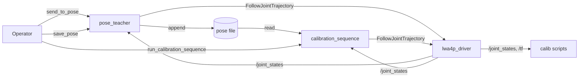

# lwa4p_calibration_poses

Teaches joint poses for hand-eye calibration of the Schunk LWA 4P and replays them as a repeatable calibration sequence.

## Overview

The package contains two nodes that share one pose file.

- `pose_teacher` moves the arm to joint positions typed by the operator and saves the actual joint positions of good poses into the pose file.
- `calibration_sequence` moves the arm through every pose of the file in order and holds still at each pose, so the camera captures a static robot.

Both nodes command the arm through the `FollowJointTrajectory` action of `lwa4p_driver` (or any `joint_trajectory_controller` with the same name, e.g. on mock hardware).
They are meant to be used together with the hand-eye calibration scripts in [`RoboCup-FEI/hand-eye-calibration`](https://github.com/RoboCup-FEI/hand-eye-calibration):

- `live_calib.py` — press `SPACE` while the sequence holds a pose;
- `bag_calib.py` — record a bag while the sequence runs, the script picks the static frames itself.

> [!WARNING]
> `send_to_pose` and `run_calibration_sequence` send trajectories directly to the driver, without MoveIt.
> The motion is not checked for collisions with the table, the workspace obstacles or the robot itself.
> On the real robot, keep a person at the E-stop and teach poses in small steps.

### Workflow



### ROS interface

| Node | Kind | Name | Type | Description |
|---|---|---|---|---|
| `pose_teacher` | service | `send_to_pose` | `lwa4p_calibration_interfaces/srv/SendToPose` | Move to 6 joint positions [rad], responds after the motion has finished |
| `pose_teacher` | service | `save_pose` | `std_srvs/srv/Trigger` | Append the actual joint positions to the pose file |
| `calibration_sequence` | service | `run_calibration_sequence` | `std_srvs/srv/Trigger` | Execute all poses of the pose file, responds after the last pose |
| both | subscriber | `joint_states` | `sensor_msgs/msg/JointState` | Actual joint positions |
| both | action client | `arm_controller/follow_joint_trajectory` | `control_msgs/action/FollowJointTrajectory` | Arm motion |

All joint values are in radians (REP 103), ordered as the `joint_names` parameter.

### Related packages

- `lwa4p_driver` — real-robot driver, must be running with drives enabled.
- `lwa4p_calibration_interfaces` — the `SendToPose` service definition.

## How to compile

This package currently targets ROS 2 Humble and runs in the repository's Docker image (see `docker/README.md`).
The Dockerfile builds every package in `src/`, so this package is included automatically.
Build the image from the repository root:

```bash
docker build --build-arg USER_UID="$(id -u)" --build-arg USER_GID="$(id -g)" \
  -f docker/Dockerfile -t lwa4p:humble .
```

Unit tests of the logic layer (pose file and trajectory planner) run without ROS:

```bash
colcon test --packages-select lwa4p_calibration_poses
colcon test-result --verbose
```

## How to launch

Start the robot container as described in `docker/README.md`, or use `demo.launch.py` for mock hardware without a robot.
Add these options to its `docker run` command:

```bash
--ipc host --mount type=bind,src="$HOME/lwa4p_calibration",dst=/home/ros/calibration
```

The mount keeps the pose file after the `--rm` container exits; create the host directory first.
`--ipc host` replaces `--shm-size`, and any other container on `--network host` that exchanges topics with this one, e.g. the camera, needs it too.
Without it, Fast DDS tries shared memory between the containers: they discover each other, but no data arrives.

Then start both nodes inside the container:

```bash
ros2 launch lwa4p_calibration_poses calibration_poses.launch.py \
  pose_file_path:=/home/ros/calibration/calibration_poses.txt
```

> [!WARNING]
> Pressing Ctrl+C on a service call stops only the call, not the motion: the node keeps executing.
> To stop the real arm use the E-stop or `ros2 service call /lwa4p_driver/disable std_srvs/srv/Trigger`, which aborts the trajectory and also stops a running sequence.

Teach the poses:

```bash
ros2 service call /send_to_pose lwa4p_calibration_interfaces/srv/SendToPose \
  "{positions: [0.0, 0.5, 1.0, 0.0, 1.2, 0.0]}"
ros2 service call /save_pose std_srvs/srv/Trigger
```

Replay them (start the calibration script or `ros2 bag record` first):

```bash
ros2 bag record -o calib_run_1 /camera/camera/color/image_raw /camera/camera/color/camera_info \
  /tf /joint_states
ros2 service call /run_calibration_sequence std_srvs/srv/Trigger
```

`save_pose` can also save poses reached in another way, e.g. planned in RViz with MoveIt.

## Configuration

`config/calibration_poses.yaml`, shared parameters are under `/**`:

| Parameter | Default | Description |
|---|---|---|
| `joint_names` | `arm_1_joint` … `arm_6_joint` | Arm joints, defines the order of all joint vectors |
| `trajectory_action_name` | `arm_controller/follow_joint_trajectory` | Action server of the driver |
| `max_velocity_rad_s` | `0.2` | Joint velocity limit of the planned motion |
| `max_acceleration_rad_s2` | `0.2` | Joint acceleration limit of the planned motion |
| `trajectory_sample_period_s` | `0.1` | Time between trajectory points |
| `motion_timeout_margin_s` | `10.0` | Extra time over the trajectory duration before the goal is canceled |
| `settle_time_s` (`calibration_sequence` only) | `3.0` | Time to hold still at every pose |

The pose file is set by the launch argument `pose_file_path` (default `~/calibration_poses.txt`, a leading `~/` is expanded), so both nodes always use the same file.

The default limits are below the hardware limits from the `lwa4p_driver` README (about 0.5 rad/s and 0.4 rad/s², above that the motor supply trips with `0x3222`).
The driver itself rejects segments faster than its `max_velocity_deg_s` (30 deg/s).

## Pose file

One pose per line, six whitespace-separated joint positions in radians.
Empty lines and everything after `#` are ignored, so the file can be edited by hand: reorder poses, delete bad ones, or add notes.

```text
# board in the image center
0.000000 0.500000 1.000000 0.000000 1.200000 0.000000
0.300000 0.450000 1.100000 -0.200000 1.100000 0.400000  # tilted left
```

The sequence reads the file on every `run_calibration_sequence` call, so poses saved meanwhile are included without a restart.

## Design notes

- **Quintic point-to-point motion.**
  All joints start and stop together with zero velocity and acceleration.
  The duration is the shortest one that keeps every joint within `max_velocity_rad_s` (peak velocity of a quintic is 1.875·Δq/T) and `max_acceleration_rad_s2` (peak acceleration 5.77·Δq/T²).
  A single-point goal would make the driver interpolate linearly, which starts with a velocity step.
- **No start point in the trajectory.**
  The first point is at `t = sample_period`; the driver prepends its own actual position.
  A point at `t = 0` would be rejected whenever it differs from the driver's position by more than its `start_tolerance_deg`.
- **Blocking services.**
  The services respond only after the motion has finished, so the caller knows the result.
  This needs a multi-threaded executor: the service callbacks wait in one callback group while the `joint_states` subscription and the action client are served in another.
  Both services of `pose_teacher` share a mutually exclusive group, so `save_pose` never records a pose in the middle of a `send_to_pose` motion.
- **Settle time.**
  `bag_calib.py` skips images taken while any joint moves faster than 0.02 rad/s, and `live_calib.py` needs time for a `SPACE` press.
  3 s holds give both scripts enough static frames.

## Tips for good calibration poses

These come from the calibration scripts and the hand-eye method they use (`cv2.CALIB_HAND_EYE_PARK`):

- Teach at least 5 poses, 12–15 are recommended.
- `bag_calib.py` drops a pose that differs from the previous one by less than 1.5 cm and 3°.
- Vary the rotation around different axes, not only the position — translations alone do not constrain the hand-eye rotation.
- The whole ChArUco board (7×5) should be visible with at least 8 corners detected.
